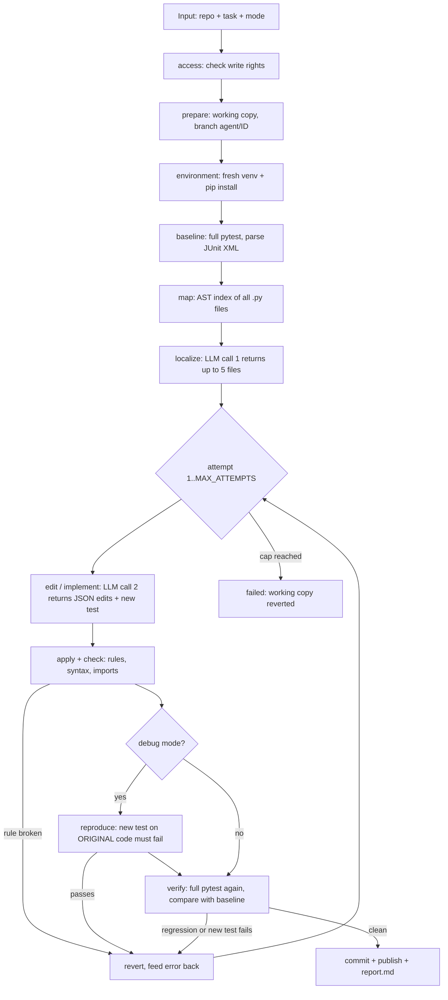

# PSI09 Repair Agent: Pipeline, Code Structure and Workflow

## 1. What it is

An AI software-engineering agent for HackNEX problem HNX26PSI09. The input is a Python repository (local folder
or git URL) and a plain-text task. The output is a small, verified code change on a new branch, a new test, and a
report that shows before/after test results.

There are two task modes:

| Mode | Edits | Extra proof |
| --- | --- | --- |
| **Debug** | existing files only | the new test must **fail on the original code**, then pass after the fix |
| **Feature** | existing files and new source files | the new test must pass; names in the request are used exactly |

Design principle: the pipeline is plain code and the LLM is used for exactly two bounded calls (pick files,
propose an edit). The LLM never touches the repository directly. Code enforces the rules, not the prompt.

## 2. End-to-end pipeline



| # | Step | File | What happens |
| --- | --- | --- | --- |
| 1 | access | `agent/repo.py` | For GitHub URLs, find out whether the user can push (`write`, `none`, `own`, `missing`). If not, ask: fork or local only. |
| 2 | prepare | `agent/repo.py` | Copy or clone into `runs/<id>/repo`; create branch `agent/<id>`. |
| 3 | environment | `agent/runner.py` | New venv, install pytest plus `requirements.txt` and `pip install -e .` if present. Failure ends the run as `env_failed`. |
| 4 | baseline | `agent/runner.py` | Full pytest to JUnit XML to `{test id: passed/failed/error/skipped}`. |
| 5 | map | `agent/repo.py` | `ast`-built list of files, functions and classes (capped at 12k chars). Syntax errors are flagged. |
| 6 | localize | `agent/pipeline.py`, `prompts.py` | LLM call 1: task + map + baseline failures returns file paths. Nonexistent or escaping paths are dropped. One retry. |
| 7 | edit | `agent/llm.py`, `prompts.py` | LLM call 2: task + file contents + last rejection returns JSON `{explanation, edits[{path,search,replace}], new_files, new_test}`. |
| 8 | apply + check | `agent/edits.py` | Test lock, search text must match exactly once, syntax check, import existence check. |
| 9 | reproduce (debug) | `agent/pipeline.py` | Stash the fix, run only the new test on the original code, restore. It must fail for the right reason. |
| 10 | verify | `agent/runner.py` | Full pytest again; `compare()` lists tests that passed before and do not now. |
| 11 | decide | `agent/pipeline.py` | Violation, regression or failing new test means revert and retry with the error as feedback. Otherwise commit. |
| 12 | publish + report | `agent/repo.py`, `report.py` | Push `agent-changes` (origin or fork) or export locally; write `runs/<id>/report.md`. |

### Safety rules enforced in code

- **Existing tests stay green.** Every test that passed at baseline must pass after the change.
- **Locked tests.** Existing test files and `conftest.py` cannot be edited (`edits.is_test_file`). Only a new test file may be added.
- **No invented imports.** Each new import must exist in the stdlib, the repo (including the imported name), or the installed packages.
- **Path containment.** Paths outside the repo or inside `.git` are rejected.
- **Bounded retries.** `MAX_ATTEMPTS` (default 5); after that the working copy is reverted and the run is `failed`.
- **Honest failures.** Outcomes are `success`, `failed` or `env_failed`; the agent never leaves a half-applied change.

### Run outcomes

`running` -> `awaiting_approval` (only when asking fork/local) -> `success` | `failed` | `env_failed`

## 3. Code structure

```
first_proto_type/
├── agent/                 core pipeline (about 1000 lines)
│   ├── pipeline.py        step order, retry loop, revert rule, MODES (debug/feature)
│   ├── repo.py            git, branch, revert/stash/commit, gh/fork/PR, local export, repo map
│   ├── runner.py          venv, dependency install, pytest, JUnit parsing, compare()
│   ├── edits.py           apply edits, test lock, syntax and import existence checks
│   ├── llm.py             Gemini client with model fallback and retries; fake provider
│   ├── prompts.py         the two prompts: localize and edit
│   └── report.py          writes report.md
├── server.py              FastAPI: API + static frontend, GitHub sign-in session
├── cli.py                 same pipeline from a terminal
├── frontend/              React + Vite + Tailwind web page (dist/ is committed)
│   └── src/               App, api, auth (Firebase GitHub login), components/
├── sample_repo/           demo repo with a known bug
├── tests/                 test_pipeline, test_edits, test_server, fake_llm_tinyauth.json
├── .env.example           GEMINI_API_KEY, GEMINI_MODEL, LLM_PROVIDER, MAX_ATTEMPTS, TEST_TIMEOUT
└── runs/<id>/             per-run output: repo/, venv/, junit_*.xml, report.md (not committed)
```

### Module responsibilities

| Module | Key functions |
| --- | --- |
| `pipeline.py` | `run()` is the public entry and always ends in a reported state; `_run()` holds the steps; `_crash_in_source()` decides whether an import crash is a valid reproduction. |
| `repo.py` | `access`, `prepare`, `revert`, `stash`/`unstash`, `commit`, `publish`, `open_pr`, `export_local`, `repo_map`, token handling for per-user GitHub actions. |
| `runner.py` | `setup_env`, `run_tests`, `compare`, `counts`, `EnvError`. |
| `edits.py` | `apply`, `check`, `is_test_file`, `EditError`. |
| `llm.py` | `complete` (5 retries, backoff, model rotation), `complete_json`, `LLMError`. |
| `server.py` | `POST /api/run`, `GET /api/run/{id}`, `POST /api/run/{id}/approve`, `POST /api/run/{id}/pr`, `/api/me`, `/api/session`, `/api/repos`. |

### Technology

Python 3.11+ (`subprocess`, `venv`, `ast`, `xml.etree`), Git, GitHub CLI, pytest, Google Gemini (`google-genai`),
FastAPI + uvicorn, python-dotenv, Firebase Auth (GitHub OAuth), React + Vite + Tailwind + anime.js.
A scripted fake LLM (`LLM_PROVIDER=fake`) runs the whole pipeline offline, which separates our bugs from model errors.

## 4. Workflow

### 4.1 User workflow (web)

1. `python server.py`, open `http://localhost:8000`.
2. Optionally **Sign in with GitHub** (needed for URL repos and GitHub modes; local folders work signed out).
3. Enter the repo (folder path or URL), the task text, choose **Debug** or **Add feature**, and pick the target
   (my GitHub repo, someone else's public repo, or local only).
4. **Run.** The page polls `GET /api/run/{id}` and shows each step live in `Progress`.
5. If write access is missing, the run pauses at `awaiting_approval`; the user answers fork or local
   (`POST /api/run/{id}/approve`). Unanswered after an hour means local.
6. `Results` shows the explanation, before/after counts, regressions, new tests, verified imports and the diff.
7. Optionally **Open pull request** (asks for confirmation first, `POST /api/run/{id}/pr`).

### 4.2 CLI workflow

`python cli.py <repo> "<task>" [--feature] [--fork|--local]` runs the same `pipeline.run()`, prints steps, and
uses the `gh auth login` identity of the machine.

### 4.3 Request flow inside the server

```
browser -> POST /api/run -> validate (choose()) -> thread: pipeline.run(...)
                         <- {id}
browser -> GET /api/run/{id} (poll) <- state {status, steps[], result{}}
pipeline.on_step -> RUNS[id] = state   (in-memory; reports persist on disk)
```

The server stores state in memory (`RUNS`), so a restart loses live state but not `runs/<id>/report.md`.
A background thread binds the starting user's GitHub token, so the run keeps acting as that user even if they sign out.

### 4.4 Developer workflow

```
python -m venv .venv && .venv\Scripts\python -m pip install -r requirements.txt
copy .env.example .env                  # add GEMINI_API_KEY, or set LLM_PROVIDER=fake
.venv\Scripts\python -m pytest tests    # end-to-end (fake LLM) and safety-rule tests
cd frontend && npm install && npm run build   # only if the UI changes; dist/ is committed
```

## 5. Known limits and next steps

- The import check covers imports, not every attribute or call; the full test run catches most invented calls.
- Tests run once, so a flaky test can look like a regression (no rerun guard yet).
- No baseline exists for repos with no tests; the report says so.
- Local repos are snapshotted without git history.
- Feature mode can only follow names and signatures the request spells out.
- One signed-in user at a time; Python and pytest only.
- Stretch ideas: per-user sessions, a JavaScript (`npm test`) adapter, flaky-test rerun, keyword-search fallback
  for localization, GitHub issue link ingestion.
